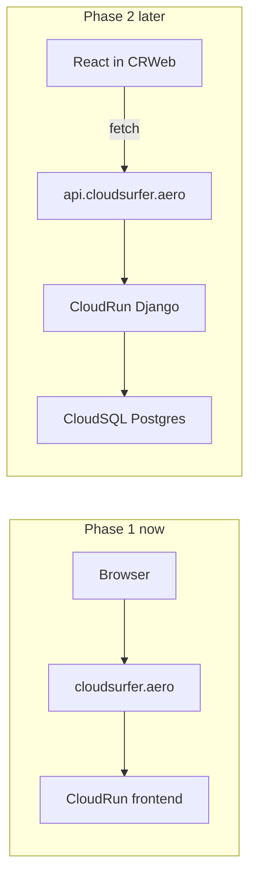

# Cloud Run hosting (frontend now, Django later)

## Target architecture



- **Now:** one public Cloud Run service serves `frontend/dist/` via **nginx** (multi-stage Docker image).
- **Later:** second Cloud Run service in [`backend/`](backend/) + **Cloud SQL**; React calls `https://api.cloudsurfer.aero` (env-based API URL). No monolith container unless you change approach later.

**Your choices:** manual `docker build` + `gcloud run deploy`; **replace** GCS hosting in docs and remove `build:gcs`.

---

## Repo changes (implementation)

### 1. Container for the static site

Add under [`frontend/`](frontend/):

| File            | Purpose                                                                                        |
| --------------- | ---------------------------------------------------------------------------------------------- |
| `Dockerfile`    | Stage 1: `node` → `npm ci` + `npm run build`. Stage 2: `nginx:alpine` copies `dist/` + config. |
| `nginx.conf`    | Serve static files; `try_files` → `index.html` for SPA routes (future-proof).                  |
| `.dockerignore` | Exclude `node_modules`, local `dist` from context (build produces fresh `dist` in image).      |

Keep Vite **`base: '/'`** only — remove `gcs` mode from [`frontend/vite.config.js`](frontend/vite.config.js) and **`build:gcs`** from [`frontend/package.json`](frontend/package.json).

### 2. Documentation

- **Replace** [`docs/gcp-static-hosting.md`](docs/gcp-static-hosting.md) with **`docs/gcp-cloud-run.md`** (or rename in place): project `cloudsurfer`, region **`europe-west1`**, service name e.g. `cloudsurfer-web`.
- Sections: prerequisites (APIs, billing, `gcloud` config), **one-time** Artifact Registry repo (or `gcr.io`), build & deploy commands, **public access** (`--allow-unauthenticated` + note on org **Domain restricted sharing** if `allUsers` on `run.invoker` fails like Storage did), **custom domain** mapping for `cloudsurfer.aero` / `www`, deploy loop after content changes, cost tips (`min-instances=0`, small CPU/memory).
- Short **“Later: Django”** section: second service, Cloud SQL, subdomain — point to [`backend/README.md`](backend/README.md).
- Update [`README.md`](README.md) and [`frontend/README.md`](frontend/README.md) links; remove GCS / `build:gcs` mentions.

### 3. Optional convenience (small)

- Root or `frontend/` script snippet in doc only, or a minimal `scripts/deploy-frontend.sh` that runs build + docker + deploy (documented, not required for CI).

No Cloud Build in this phase (per 1a).

---

## GCP steps you will run (documented, not automated in repo)

1. **Enable APIs:** Cloud Run, Artifact Registry, (Cloud Build API optional if only local docker push).
2. **Artifact Registry:** e.g. `europe-west1-docker.pkg.dev/cloudsurfer/cloudsurfer/web`.
3. **Build & push** (from repo, context `frontend/`):

   ```bash
   docker build -t REGION-docker.pkg.dev/cloudsurfer/REPO/web:latest .
   docker push ...
   ```

4. **Deploy:**

   ```bash
   gcloud run deploy cloudsurfer-web \
     --image ... \
     --region europe-west1 \
     --allow-unauthenticated \
     --min-instances 0 \
     --memory 256Mi
   ```

5. **Custom domain:** Cloud Run → service → **Manage custom domains** → add `cloudsurfer.aero` and `www.cloudsurfer.aero` → apply DNS records at registrar → wait for cert **ACTIVE**.
6. **DNS:** Point apex/`www` per Google’s mapping UI (not the old global LB + bucket path).

**Decommission (optional, after Cloud Run works):** stop using `gs://cloudsurfer-aero` for the site; bucket can be deleted later to avoid stray public objects (not required in code change).

---

## Org policy reminder

If `allow-unauthenticated` or IAM binding for public invoke returns **412 / permitted customer**, use the same pattern as Storage: **project-level override** on Domain restricted sharing for project `cloudsurfer` only — not org-wide disable.

---

## Learning flow (when implementing)

1. Explain Dockerfile stages (why nginx, why build inside image).
2. First deploy to default `*.run.app` URL; verify site.
3. Map domain; switch DNS.
4. Walk through one content change: edit `profile.js` → rebuild image → redeploy.

---

## Out of scope (this plan)

- Django, Cloud SQL, Cloud Build triggers
- Firebase, GCS website, HTTPS load balancer + backend bucket
- CI/CD
