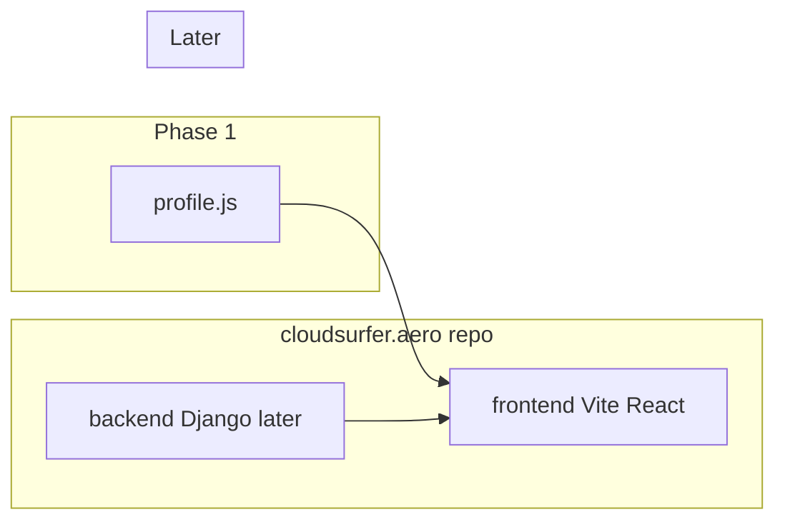

# Cloudsurfer.aero — frontend-first aviation CV (monorepo)

## Where this lives

The empty directories already exist in **WSL Ubuntu**:

- Work here: [`/home/mn/code/cloudsurfer.aero`](/home/mn/code/cloudsurfer.aero)
- Later (not this phase): `/home/mn/code/cloudsurfer.online`, `/home/mn/code/cloudsurfer.io`

On confirm, the first action is `move_agent_to_root` into `cloudsurfer.aero`, then `git init` and a **frontend / backend split inside this same repo**. Work stays in WSL so paths match what you specified.

## Repo layout (one repo, two directories)

```
cloudsurfer.aero/          # git root
  frontend/                # Vite + React app (phase 1 work)
    src/
      data/profile.js      # all text, lists, image paths
      components/
      App.jsx
      main.jsx
    public/images/
    index.html
    package.json
  backend/                 # Django later; empty placeholder now
    README.md              # what this folder is for
  README.md
```

- **Phase 1:** only `frontend/` is a real app. `backend/` exists so the split is obvious; we do not create a Django project yet.
- **Later:** Django lives in `backend/` in this same repo (API, CMS, auth). The React app stays in `frontend/` and will `fetch` the API instead of importing `profile.js`.

Vite is created **inside `frontend/`**, not at the repo root (`npm create vite@latest .` from that directory).



## What we are building now (phase 1)

A **single-page personal aviation CV** — hardcoded name, text, and images in the frontend. No login, no CMS, no Django yet.

Stack (your list, plus Vite as the React build tool — how we run and bundle React):

- HTML (via React components)
- CSS + **Tailwind** for layout/spacing
- **shadcn/ui** for a few polished pieces (buttons, cards, separator) — not every widget
- JavaScript + **React** (plain JS, not TypeScript, so it matches “still learning JS/React”)
- **Django** later, in `backend/`
- **GCP** later for hosting

Each step in chat will include a short explanation: what the file is, why it exists, and what you’d change later.

## Layout we will implement

A simple vertical “CV site,” mobile-friendly:

1. **Header** — name, “Pilot” title, nav jumps to sections
2. **Hero** — photo + one-paragraph intro
3. **Qualifications** — licenses, ratings, hours (cards)
4. **Experience** — flying / aviation roles (timeline)
5. **Education / training**
6. **Contact** — email / links (static)

Placeholder copy and a photo path first; you replace real bio, hours, and images when you have them.

## Tooling choices (kept small)

- **Vite + React** inside `frontend/`
- **Tailwind** for page layout
- **shadcn/ui** added after Tailwind works — only what we use
- **No React Router** until we need extra pages (login, editor)
- **No Django scaffolding yet** — only the `backend/` directory and a short README so the split is in place

## GCP (phase 1 deploy, after the page looks right locally)

Static site from the frontend only:

1. `npm run build` in `frontend/` → `frontend/dist/`
2. Upload to a **Cloud Storage** bucket configured as a website
3. Optional: custom domain `cloudsurfer.aero` + HTTPS via Cloud Load Balancing / Cloud CDN once the domain DNS is yours

Later: static React can stay on GCS/CDN; Django on **Cloud Run** + Cloud SQL. We will not provision Django or Cloud Run in phase 1.

You will need a GCP project and `gcloud` auth when we get to deploy; local `npm run dev` in `frontend/` does not need that.

## Explicitly later (not in the first implementation)

- Django project inside `backend/` (REST API + admin / in-page editing)
- Auth and **multiple users** each with their own aviation CV
- `cloudsurfer.online` and `cloudsurfer.io` (leave those folders empty)

Direction so we do not paint into a corner: content in `frontend/src/data/profile.js`, no secrets in the frontend, domains as separate repos later if you want.

## Learning cadence

We go **one milestone at a time**, with explanation before/after each:

1. Git + `frontend/` + `backend/` + first React render
2. Tailwind + one shadcn component
3. Split the page into components + `profile.js`
4. Polish CV sections
5. Production build
6. GCP static hosting
